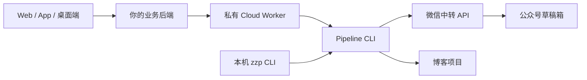

# zzhub-pipeline

一个可恢复的内容发布工作流。它把 Markdown、图片、账号和发布意图组织成一条明确的流水线，生成微信公众号草稿，或把文章同步到自己的博客项目。

Pipeline 可以独立使用，也可以作为 Web、App、桌面客户端背后的执行服务：

- **本机 CLI**：在本地准备、排版、渲染和写入草稿。
- **私有 Cloud Worker**：在服务器执行同一套 Pipeline，业务后端通过 HTTP 提交任务。
- **Agent 编排**：Agent 负责写稿、审核和修订，Pipeline 负责确定性的状态推进。

微信的 `publish` 只会创建或更新草稿，不会群发或公开发布。博客路由会执行你配置的发布命令，实际效果由该命令决定。

> Cloud Worker 已在本仓库实现，可从源码构建 Docker 镜像部署。它不包含在 npm CLI 包中；npm 只分发 CLI 和渲染资源。`v0.14.0` tag 包含初版 Worker，账号同步和正文模板等接口以实际部署的 revision 为准，生产环境请固定 commit/tag。

## 生态与使用者

本仓库是发布执行层，供本机用户、Agent 和应用后端调用。以下都是可独立使用的公开仓库；npm 包统一使用 `@akairos` scope，GitHub 仓库位于 `k7airos`。

| 项目 | 与 Pipeline 的关系 | 什么时候使用 |
| --- | --- | --- |
| [myno](https://github.com/k7airos/myno) · [`@akairos/myno`](https://www.npmjs.com/package/@akairos/myno) | 可选的正文编辑、排版与 Studio 插件，配置 `plugins.markdownRenderer` | 交互调样式、导出独立配置、复制富文本；也能脱离 Pipeline 独立运行 |
| [Typeset Studio](https://github.com/k7airos/typeset-studio) · [`@akairos/typeset-studio`](https://www.npmjs.com/package/@akairos/typeset-studio) | 图片渲染插件，配置 `plugins.imageRenderer` | 设计与渲染文章封面、贴图封面和多页内容图 |
| [Milkdown Article Plugins](https://github.com/k7airos/milkdown-article-plugins) | Pipeline 与 myno 共用的语法、序列化和微信组件渲染 | 给自己的 Milkdown 宿主接入高亮、提示卡、徽章和快捷键 |
| myno CSS 入口 | `@akairos/myno/article.css` 与 `tokens-default.css`，统一提供正文排版和主题变量 | 仅复用样式时无需加载编辑器脚本 |
| [Obsidian 微信发布插件](https://github.com/k7airos/obsidian-wechat-publish) | 通过本机 `zzp` 调用 Pipeline 的桌面客户端 | 在 Obsidian 内提交笔记到公众号草稿箱 |
| [Kairos Skills](https://github.com/k7airos/kairos-skills) | 外部 Agent 的写作规范、审核与状态机编排说明 | 让 Agent 按 `status → next_action` 写稿和推进任务 |
| [blog.zzao.club](https://github.com/k7airos/blog.zzao.club) | 博客路由的公开消费方和目录约定示例 | 将文章同步到 Nuxt Content，再执行自定义发布命令 |
| [Bun 微信中转服务](https://github.com/k7airos/bun-wx-server) | 可参考的自托管认证、COS 与基础微信代理实现 | 研究中转 API；当前只覆盖部分微信端点，接入限制见该仓库 README |

Nezus 也是现有消费方：桌面端调用本机 CLI，云端通过业务后端调用 Worker。它是独立应用，不是安装 Pipeline 的前提。Pipeline 不依赖任何私有仓库才能启动或本地排版。

## 能做什么

| 能力 | 说明 |
| --- | --- |
| 公众号文章 | Markdown 转微信兼容 HTML，生成自适应头图，上传图片，创建或更新文章草稿 |
| Markdown 与扩展组件 | 支持 CommonMark/GFM、Callout、导读/互动卡、徽章、按键和高亮；微信导出范围见正文模板文档 |
| 封面裁切 | 按真实图片尺寸计算 2.35:1 与右对齐 1:1 裁切参数；仍需符合微信素材要求 |
| 公众号贴图 | 渲染单页卡片或多页 PNG 图集，创建 `newspic` 草稿 |
| 博客同步 | 把 Markdown 和图片同步到配置的博客项目，并执行发布命令 |
| 可恢复工作流 | 保存任务状态、素材、审核决定、渲染版本和发布结果，失败后可以继续或重置 |
| 多账号与多目标 | 支持多个公众号账号，以及微信、博客等发布目标 |
| 排版扩展 | 封面主题、正文模板、品牌配置和可替换渲染插件 |
| 排版工作台 | `zzp wechat-preview studio` 提供所见即所得排版调优、配色选型、语法预设与配置持久化 |
| 本机监控 | `zzp monitor` 提供任务快照、日志和 SSE 事件流 |
| 云端执行 | 私有 HTTP Worker 提供账号同步、串行队列、持久化任务和状态轮询，运行中可附带当前动作进度 |

Pipeline 不内置 LLM、用户登录、计费或配额服务。调用方需要自己提供正文和审核决定；云端 Worker 接收已经确认的完整正文，并只推进支持的 CLI 动作。

## 工作方式



客户端不需要运行 Electron，也不需要直接访问 Worker。推荐让业务后端负责用户鉴权、账号归属、任务归属、配额和幂等键隔离，再通过内部网络调用 Worker。

## 快速开始

### 安装

Pipeline 需要 [Bun](https://bun.sh/) 运行。npm 可以安装包，但命令本身仍由 Bun 执行；渲染文章还需要 Chrome 或 Chromium。

```bash
# 从 npm 安装
npm install -g @akairos/pipeline

# 或从源码运行
git clone https://github.com/k7airos/zzhub-pipeline.git
cd zzhub-pipeline
bun install
bun run src/cli.ts --help

# 可选：把当前源码安装成全局命令
bun install --global .
```

两个命令别名都可用：

```bash
zzp --help
zzhub-pipeline --help
```

检查本机依赖：

```bash
zzp doctor
```

图片渲染需要 `@napi-rs/canvas`，COS 上传需要 `cos-nodejs-sdk-v5`。云端 Docker 镜像会安装 Chromium 和 CJK 字体。

### 先预览一篇文章

下面的命令只生成本地产物，不访问公众号：

```bash
zzp wechat-export \
  --markdown ./article.md \
  --out ./article.html \
  --preview-shell-out ./article-preview.html \
  --no-preview
```

### 视觉排版工作台 (WeChat Visual Studio)

启用 [myno 排版插件](#myno-排版插件) 后，下面的命令加载 myno 随 npm 包提供的工作台；未配置插件时使用 Pipeline 内置工作台：

```bash
zzp wechat-preview studio
```

终端启动后会自动唤起浏览器打开 `http://127.0.0.1:18765/studio`。可调整主题配色、字号行距、标题/引用/分割线等预设和自定义 CSS；提示卡片的标题与 Emoji 写在 Markdown 中。调整后可复制富文本、导出独立 JSON，或保存到当前账号配置。

> **云端使用者注意**：本地 Studio 保存的样式会写入本地 `config.json`。若使用私有云端 Worker，需将调整后的配置同步至服务器，详见 [Visual Studio 排版调优与云端配置同步指南](docs/visual-studio-and-config-sync.md)。

### 公众号全语法与扩展组件

Pipeline 与 myno 基于 `@akairos/milkdown-article-plugins` 和 myno 内置正文样式支持以下扩展，导出时转换为微信兼容的内联样式：

#### 1. 语义提示卡片 (Callout Alerts)
支持 GFM 标准的 5 种语义卡片，并支持行内自定义标题与 Emoji：
```markdown
> [!NOTE]
> 标准提示卡片，采用温和中性灰，适合补充背景说明。

> [!TIP] 实用技巧
> 自定义标题技巧卡片，非常适合放置操作小窍门。

> [!WARNING] ⚠️ 重点防护
> 自定义标题与 Emoji 的警告卡片，橙黄双色渐层强化视觉警示。

> [!IMPORTANT]
> 关键要点卡片，适合陈述架构必须原则或核心结论。

> [!CAUTION]
> 破坏性操作警告卡片，深红醒目提示。
```

#### 2. 导读卡与关注引导卡 (Article Cards)
专为公众号排版设计的文章头尾卡片：
```markdown
> [!INTRO]
> 眉题：大模型前沿实战
> 作者：Kairos · 阅读时间：3 分钟
> 本篇系统实测 Kairos 排版引擎在微信生态下的完整视觉呈现。

> [!CTA]
> 感谢阅读本次排版效果实测！
> 欢迎关注公众号，获取第一手排版组件与工程实战经验。
```

#### 3. 行内组件 (Badge / Kbd / Highlight)
- **状态徽章**：`[badge:brand|推荐]`、`[badge:success|运行正常]`、`[badge:warning|待确认]`、`[badge:danger|异常]`、`[badge:info|说明]`
- **键盘按键**：按 `[[kbd:Cmd]] + [[kbd:K]]` 快速调起指令，按 `[[kbd:Shift]] + [[kbd:Enter]]` 换行
- **荧光笔高亮**：使用 `==荧光笔标记核心概念与重点论述==`

#### 4. 智能居中防拉伸分割线 (Divider)
标准 Markdown `---` 可应用 Studio 中配置的分割线预设（如 `short-center`、`dashed`、`hairline`），导出为微信可用的结构和内联样式。

#### 5. 智能封面裁切比率自动适配
Pipeline 在创建和更新草稿时读取封面图真实尺寸，默认裁切最右侧的 1:1 区域（纵向居中），并生成 `pic_crop_235_1` 与 `pic_crop_1_1` 参数。此处解决裁切几何问题，不能保证绕过微信的其他内容或素材校验。

### 模块化生态组成

| 模块包名 | 职责说明 |
| --- | --- |
| **`@akairos/pipeline`** | 核心可恢复状态机、CLI 工具链与多端发布器 |
| **`@akairos/myno/article.css`** | Kairos 原创微信排版 CSS 样式规范与设计令牌，随 myno 维护 |
| **`@akairos/milkdown-article-plugins`** | Remark / Milkdown 文章扩展语法与渲染插件 |
| **`@akairos/myno`** | 可独立运行的正文编辑器、样式工作台与可选 Markdown 渲染插件 |
| **`@akairos/typeset-studio`** | 微信大图头图、多比例排版与卡片视觉合成引擎 |

配置在 `plugins.imageRenderer` / `plugins.markdownRenderer` 的外部插件在独立 Bun 子进程中加载，插件的 `render`、`doctor`、`browser` 和 `studio` 方法也在子进程调用。加载、资源入口查询与 doctor 默认上限为 10 秒，`render` 为 120 秒；Markdown 渲染显式传入 `timeoutMs` 时，子进程上限额外预留 10 秒。可通过 `ZZHUB_PIPELINE_PLUGIN_TIMEOUT_MS` 覆盖子进程调用上限。同步死循环、超时和异常退出会终止插件进程，非法返回值会给出 `PLUGIN_*` 错误，命令不会自动重试或静默切换模板。浏览器型插件返回入口后，由 pipeline 现有 Chrome 运行时加载页面，并按渲染 `timeoutMs` 管理浏览器生命周期。

图片渲染失败后任务进入失败状态，保留正文与审核结果。修复插件后执行 `zzp reset --state <state_path> --mode render`，再继续任务；也可以将对应的 `plugins.*Renderer` 配置设为 `null` 使用内置渲染器。外部插件通过 `onProgress` 回传进度，不应依赖修改输入对象或跨调用保存内存状态。子进程继承当前环境和文件权限，这一机制负责故障隔离，不是权限沙箱。

### 插件入口与专属配置

`plugins.imageRenderer` 与 `plugins.markdownRenderer` 都支持 `{ "module": "包名或文件路径", "options": {} }`。`module` 指定适配器入口，`options` 保存该插件的详细规则，可包含嵌套对象和数组；pipeline 校验入口结构，将参数传给插件的 `doctor(options)` 和 `render(input, options)`，参数含义与业务校验由插件负责。两个渲染器分别接收自己的参数。

旧的字符串入口继续有效，等同于没有配置专属参数；`null` 使用内置渲染器。`zzp config --import` 中的渲染器条目整体替换原条目，只改一个参数时使用 `--key plugins.imageRenderer.options.<参数名>`。

### myno 排版插件

Pipeline 0.19.1 起固定依赖 `@akairos/myno@0.3.1`，内置导出与插件共用 myno 正文 CSS。使用 myno 完整排版和工作台时，仍需在配置中显式选择插件。npm 配置示例：

```json
{
  "plugins": {
    "markdownRenderer": {
      "module": "@akairos/myno/adapter",
      "options": {}
    }
  }
}
```

本地开发时可先在 myno 仓库执行 `bun run build`，将 `module` 指向构建后的 `dist/adapter.js` 绝对路径。运行时部署包只接受 npm 入口和空 `options`，不会复制本机插件路径。

插件可以实现原有的 `render(input, options)`，也可以像 myno 一样只实现 `browser(options)`，返回浏览器排版入口的绝对路径 `{ scriptPath }`。`wechat-export` 和公众号文章发布通过同一个插件加载器调度；浏览器型插件复用 pipeline 现有的 Chrome、超时清理、离线模板校验和文件输出，仅页面排版实现来自插件。myno 不增加浏览器自动化依赖，调样式和导出 config 也不需要启动无头浏览器。独立样式仍与发布账号分离。

Markdown 插件可选提供 `studio(options)`，返回绝对资源目录 `root` 和该目录内的 HTML 相对路径 `entry`。`zzp wechat-preview studio` 将插件页面挂到 `/studio`，脚本和样式挂到 `/studio-assets/`；`/api/studio/config`、`/api/studio/save-config` 和历史记录继续由 pipeline 提供。插件不支持 Studio 时返回明确提示；配置为 `null` 保留内置工作台。切换插件后需重启已运行的预览服务。

### Typeset Studio 插件配置

Pipeline 已通过 npm 依赖 `@akairos/typeset-studio`。在本地配置文件启用适配器，并指定与 Studio 编辑器共用的数据目录：

```json
{
  "plugins": {
    "imageRenderer": {
      "module": "@akairos/typeset-studio/adapter",
      "options": {
        "dataDir": "/absolute/path/typeset-studio/data"
      }
    }
  }
}
```

保存上述入口后，也可使用 `zzp config --key plugins.imageRenderer.options.dataDir --value /absolute/path/typeset-studio/data` 更新目录。相对目录按 pipeline 配置文件所在目录解析。当前 Studio npm 适配器仍从环境变量读取目录，pipeline 将该参数兼容传为插件子进程的 `TYPESET_DATA_DIR`，已有非空 `TYPESET_DATA_DIR` 优先，不修改主进程环境。

插件在 Bun 子进程内直接导入 npm 适配器并调用内部排版和 Canvas 方法，不请求 Studio HTTP 服务，也不需要管理员密钥。子进程用于超时与故障隔离。pipeline 调用时屏蔽 Studio 适配器的远程地址和密钥环境变量，保证使用本地渲染。只有单独启动 Studio HTTP 服务时需要配置服务鉴权。

Studio 模板与 pipeline 配置分开保存：`data/templates/*.json` 保存模板，`data/default-template.json` 保存全局及账号槽位，`data/uploads/` 保存上传图片。请使用包目录之外的持久化目录，避免重新安装包影响自己的数据。在服务器运行 pipeline 时，同样通过 npm 插件直接渲染，将上述文件同步到服务器，并让 `plugins.imageRenderer.options.dataDir` 指向该目录即可；只传模板 JSON 不会迁移 `/uploads/...` 图片。

固定素材的 `templateAssetKey` 是模板内的替换标识，图片来源仍是 `images[].src`。支持可访问的 HTTP/HTTPS URL、本地文件及 `/uploads/...` 引用。使用 `/uploads/...` 时应连同 `uploads/` 目录原文件名一起同步；绝对路径应改为服务器可用路径，或把素材上传到 COS/CDN 后使用稳定 HTTPS URL。编辑器预览远程图片还需要图片服务允许跨域读取。

**版本基线（2026-10-15）：** Pipeline `0.19.2` 固定 Typeset Studio `0.2.7` 和 myno `0.3.1`；插件仍需显式配置。模板与素材不打进 npm 包，服务器通过运行时配置包提供。源码适配器路径仅用于本地联调，Worker 使用 npm 入口。

### 生成 Worker 运行时配置包

模板和 Markdown 账号样式可以一起生成一个不含密钥的运行时包：

```bash
zzp typeset-assets-sync --dry-run
zzp typeset-assets-sync --output ./pipeline-runtime
# 云端账号键与本机不同：仅将样式和默认槽位映射到目标账号，不传凭据
zzp typeset-assets-sync --output ./pipeline-runtime --account-map '{"default":"WORKER_ACCOUNT_KEY"}'
```

命令扫描模板引用的本地文件和 Base64 图片，使用现有 COS 配置上传；图片 URL 验证成功后，备份并回写模板，再生成带逐文件 SHA-256 的 `manifest.json`、`pipeline.patch.json`、`typeset-studio/` 和 `markdown/`。上传记录按目标和图片内容保存，重复执行复用成功上传；本地原图保留。上传或校验失败保留模板和旧输出包，上传期间的模板修改会触发冲突提示。`--template` 仅限制本次素材迁移范围，输出仍包含全部模板；其他模板存在未迁移素材时拒绝生成不完整包。

配置包只包含插件入口、Studio 容器路径和账号主题/CSS/文章模板路径，不包含微信凭据、COS PAT 或 Worker token。账号的 `customCss`、`articleTheme` 为 null 时会清除服务器旧引用。Markdown 插件只导出 `null` 或 `@akairos/myno/adapter` npm 入口和空 `options`，不导出本机模块路径。自托管时按文件哈希校验、备份和样式白名单合并后切换；项目自己的部署工具可消费此包，镜像与 npm 依赖仍需固定版本。

WeChat Visual Studio 可通过「导出配置」下载不绑定账号的独立排版 JSON。CLI 用 `--article-theme ./wechat-style.json` 选择；在默认配置的账号 `articleTheme` 中引用后，也会由上述运行时包收集部署。文件内嵌 CSS 与页首图片，无需附带模板目录。详见 [Studio 独立配置与部署](docs/visual-studio-and-config-sync.md)。

### 推进一个发布任务

Pipeline 每次只推进一个动作。创建任务后，反复执行 `status`，按照返回的 `next_action` 继续；不要直接修改 `workflow-state.json`。

```bash
WORKSPACE="$PWD/workspace"

zzp init \
  --workspace "$WORKSPACE" \
  --task-kind publish \
  --content-form article \
  --content-origin user \
  --targets wechat \
  --intent-text "发一篇公众号文章"

# init 会返回 state_path；后续命令使用它
zzp status --state "$WORKSPACE/.zzhub-media/runs/<run_id>.json" --view agent

# 正文可以来自文件，也可以使用 --body-text
zzp attach-body \
  --state "$WORKSPACE/.zzhub-media/runs/<run_id>.json" \
  --body ./article.md

# 后续按 status 的 next_action 执行，常见顺序如下
zzp prepare --state <state_path>
zzp review --state <state_path> --status passed
zzp prepare-finalize --state <state_path>
zzp render --state <state_path>
zzp publish --state <state_path>
```

实际顺序以 `status --view agent` 为准。需要发布贴图时，把 `--content-form` 改为 `newspic`；多页图片可以在渲染前附加 `newspic` 规格。

如果正文由 Agent 生成或审核，可以使用配套的 [kairos-skills](https://github.com/k7airos/kairos-skills) 仓库中的 [`zzhub-publish` Skill](https://github.com/k7airos/kairos-skills/tree/main/skills/zzhub-publish/SKILL.md)。Skill 负责编排 Agent 状态机，文章正文仍由调用方提供。

## 云端 Worker

Worker 是仓库里的独立 Bun 服务，入口为 `services/cloud-worker/server.ts`。它在服务器上调用 Pipeline CLI，当前支持公众号 `article` 和 `newspic` 任务，不支持博客任务，也不提供任意命令执行。

推荐链路：

```text
Web / App / 桌面端
        ↓
已鉴权的业务后端
        ↓  内部网络 + PIPELINE_WORKER_TOKEN
Cloud Worker
        ↓
Pipeline CLI → 微信中转 API → 草稿箱
```

Worker 已经可以部署，但应作为**内部服务**使用：

- 默认监听 `127.0.0.1:18887`。
- 非回环监听必须显式设置 `PIPELINE_WORKER_PRIVATE_NETWORK=1`，并由容器网络或防火墙完成隔离。
- `PIPELINE_WORKER_TOKEN` 是服务令牌，不是用户登录 token，也不是微信中转 PAT；不要下发给客户端。
- 当前是单进程串行队列，使用 JSON 文件保存任务、正文和账号；数据目录必须挂载持久卷，不支持多个副本共享同一目录。
- 任务状态为 `queued`、`running`、`succeeded`、`failed` 或 `interrupted`，`step` 表示当前 Pipeline 动作。
- Worker 轮询返回步骤、结果和可选当前动作进度，不提供云端 SSE 或原始日志。本机 `zzp monitor` 是另一套观测接口。

最短 Docker 启动示例：

```bash
docker build -f services/cloud-worker/Dockerfile \
  -t zzhub-pipeline-worker:local .

# 让业务后端和 Worker 只在内部网络通信
docker network create pipeline-internal

docker run -d --name pipeline-worker --restart unless-stopped \
  --network pipeline-internal \
  -e PIPELINE_WORKER_TOKEN \
  -e PIPELINE_WORKER_HOST=0.0.0.0 \
  -e PIPELINE_WORKER_PRIVATE_NETWORK=1 \
  -e PIPELINE_CONFIG_FILE=/run/secrets/pipeline.json \
  --mount type=bind,src=/absolute/path/to/pipeline.json,dst=/run/secrets/pipeline.json,readonly \
  --mount type=bind,src=/absolute/path/to/worker-data,dst=/data \
  zzhub-pipeline-worker:local
```

业务后端使用同一个服务令牌调用：

| 方法 | 路径 | 用途 |
| --- | --- | --- |
| `GET` | `/health` | 查看 Worker 是否存活、排队数和账号数 |
| `PUT` | `/v1/maintenance` | 暂停或恢复接收新任务，供维护更新使用 |
| `PUT` | `/v1/accounts/:account` | 写入或替换公众号凭据 |
| `DELETE` | `/v1/accounts/:account` | 删除 Worker 中的公众号凭据 |
| `POST` | `/v1/jobs` | 提交完整正文，返回 job ID |
| `GET` | `/v1/jobs/:id` | 查询步骤、状态和发布结果 |

正文必须在 Worker 环境中可读取。客户端本机路径不会自动上传；正文中的图片应使用 Worker 可访问的 URL，或使用请求允许的 Base64 数据。相同 `idempotencyKey` 且输入不变时会返回已有任务，输入变化要使用新的键。

详细的环境变量、请求字段、Docker 网络、更新和故障恢复流程见 [`services/cloud-worker/README.md`](services/cloud-worker/README.md)。

### 云端恢复

`WX_RESULT_UNKNOWN`、超时或 `interrupted` 不代表草稿一定没有创建。先检查原 Pipeline run 和公众号草稿箱；确认已有草稿后，优先使用 `existingDraftMediaId` 更新。不要为了盲目重试而更换幂等键，否则可能创建重复草稿。

## 配置微信和外部服务

Pipeline 不直接调用 `api.weixin.qq.com`。公众号发布需要一个兼容以下路径的微信中转 API：

- `/api/v1/wx/cgi-bin/token`
- `/api/v1/wx/cgi-bin/material/add_material`
- `/api/v1/wx/cgi-bin/draft/add`
- `/api/v1/wx/cgi-bin/draft/update`
- `/api/v1/wx/cgi-bin/draft/batchget`
- `/api/v1/wx/cgi-bin/draft/get`
- `/api/v1/wx/cgi-bin/draft/delete`

本仓库不包含中转服务。`wx.baseUrl` 应填写中转服务地址，账号 PAT、公众号 AppID 和 AppSecret 由使用者自行保管。COS 上传使用单独的 STS API；只做本地排版时无需配置微信或 COS。

本机默认配置文件：

- macOS：`~/Library/Application Support/zzhub-pipeline/config.json`
- Linux：`~/.config/zzhub-pipeline/config.json`
- Windows：`%APPDATA%/zzhub-pipeline/config.json`

最小配置示例：

```json
{
  "paths": {
    "workspaceRoot": "/absolute/path/to/workspace"
  },
  "wx": {
    "baseUrl": "https://wx-api.example.com",
    "defaultAccount": "main",
    "accounts": {
      "main": {
        "name": "我的公众号",
        "appId": "YOUR_WECHAT_APP_ID",
        "appSecret": "YOUR_WECHAT_APP_SECRET",
        "pat": "YOUR_RELAY_API_PAT"
      }
    }
  }
}
```

配置文件含凭据，请放在受控目录，不要提交到 Git。也可以使用 `ZZHUB_PIPELINE_CONFIG` 指定其他配置路径；`ZZHUB_WX_BASE_URL`、`WX_APPID`、`WX_APPSECRET` 和 `ZZCLUB_PAT` 可覆盖对应配置。

## 状态、监控与恢复

`workflow-state.json` 是单个任务的业务真相源，记录路由、素材、阶段、渲染版本和发布结果。正文文件保存在工作区，不直接写入状态 JSON。

本机监控是可选的只读服务：

```bash
zzp monitor start
zzp monitor status
zzp monitor stop
```

它提供 HTTP 快照和 SSE，适合桌面端或本机 GUI 观察多个 CLI 执行。它不负责调度、重试或取消，也不应暴露到公网。详见 [`docs/monitor.md`](docs/monitor.md)。

## 其他文档

- [Visual Studio 排版调优与云端配置同步指南](docs/visual-studio-and-config-sync.md)
- [文章发布入门](docs/cli-intro-for-article.md)：面向第一次接入的使用说明
- [云端 Worker API、部署与更新](services/cloud-worker/README.md)
- [封面主题和图片排版](docs/render-themes.md)
- [离线正文模板](ARTICLE-THEMES.md)
- [Kairos Agent Skills 仓库](https://github.com/k7airos/kairos-skills)：配套的 Agent 技能集合（包含 `zzhub-publish` 状态机编排、`milkdown-writing` 写作排版规范、`auto-ai-daily` 自动化发文）
- [第三方声明](THIRD-PARTY-NOTICES.md)

## 开发与验证

```bash
bun install
bun test
bun x tsc --noEmit
bun run build:wechat-preview
bun run build
```

只修改 Worker 时可以先运行：

```bash
bun test services/cloud-worker/server.test.ts
```

`bun run build:npm` 会生成独立的 npm bundle；`services/cloud-worker/` 不在 npm 包的 `files` 清单中，Worker 需要从源码仓库构建。

## 许可

Pipeline 使用 [MIT License](LICENSE)。排版基础和第三方依赖的授权说明见 [THIRD-PARTY-NOTICES.md](THIRD-PARTY-NOTICES.md)；外部中转服务、COS 服务和第三方模板的费用、权限及许可由各自提供方负责。
